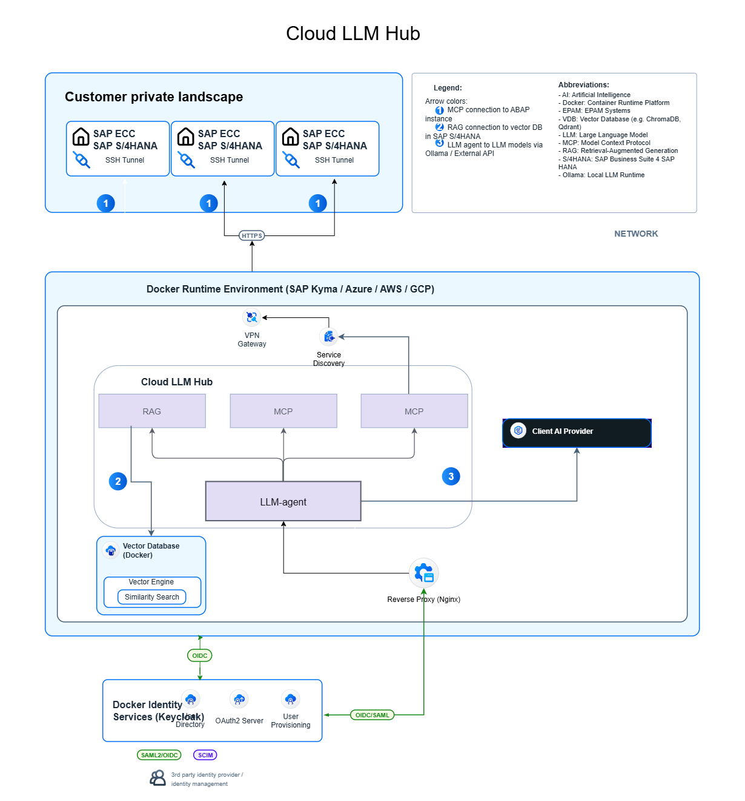

# Architecture Concepts

Deployment designs that are planned, not yet implemented. The implemented
architecture (SAP BTP Cloud Foundry) is in [ARCHITECTURE.md](../ARCHITECTURE.md).

## Client-agnostic deployment (planned)

Source: [client-agnostic-deployment.drawio](client-agnostic-deployment.drawio)

Cloud LLM Hub in a container runtime outside BTP Cloud Foundry (SAP Kyma, Azure,
AWS, GCP), against SAP ECC / S/4HANA systems in the customer's private landscape.

| Concern | Implemented (BTP CF) | This concept |
|---|---|---|
| Runtime | Cloud Foundry, MTA | Docker containers |
| Entry point | approuter | reverse proxy (Nginx) |
| Identity | XSUAA, trusted IdPs | Keycloak (OIDC/SAML, SCIM provisioning) |
| ABAP connectivity | Cloud Connector, BTP destinations | VPN gateway / SSH tunnel, service discovery |
| Vector store | in-memory, Qdrant, SAP HANA | vector database container |
| LLM | SAP AI Core, OpenAI-compatible providers | client AI provider, Ollama, external API |
