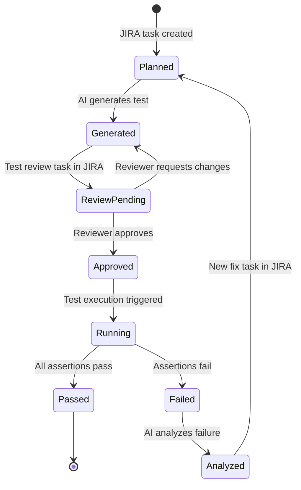
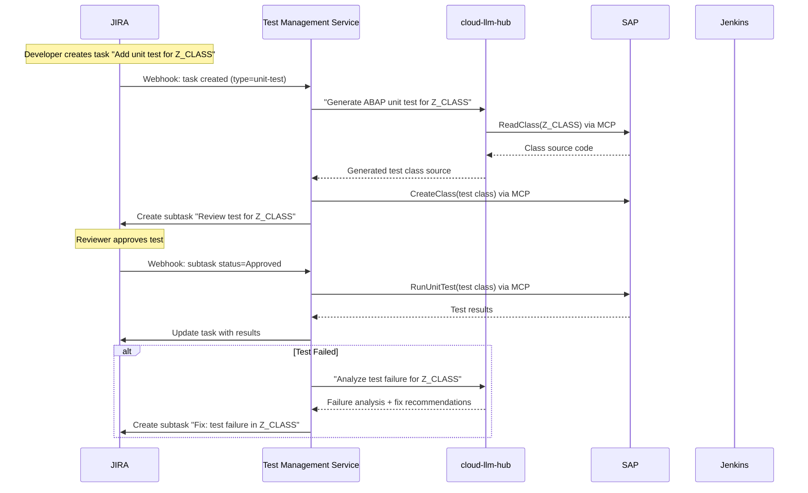

# Test Management Service — Design Document

**Status:** Draft
**Date:** 2026-04-04

## Vision

A unified test management API that covers the full test lifecycle for SAP systems — from test creation through execution to result analysis. Orchestrated from JIRA, powered by cloud-llm-hub for intelligent test generation and analysis.

## Test Lifecycle



## Four Test Directions

```mermaid
graph TB
    subgraph "Test Management Service"
        API[Unified API]
    end

    subgraph "Direction 1: ABAP Unit Tests"
        UT_CREATE[Create test class]
        UT_RUN[Run via MCP]
        UT_RESULT[Parse results]
    end

    subgraph "Direction 2: Integration Tests"
        IT_CREATE[Generate test spec]
        IT_RUN[Run via Jenkins/Pipeline]
        IT_RESULT[Collect results]
    end

    subgraph "Direction 3: Test Management"
        TM_CASES[Test cases CRUD]
        TM_PLANS[Test plans]
        TM_COVERAGE[Coverage tracking]
    end

    subgraph "Direction 4: Regression Testing"
        RT_SUITE[Test suite management]
        RT_TRIGGER[Post-transport trigger]
        RT_HISTORY[Run history & trends]
    end

    API --> UT_CREATE
    API --> IT_CREATE
    API --> TM_CASES
    API --> RT_SUITE

    JIRA[JIRA] -->|webhook| API
    API -->|status update| JIRA
    API -->|cloud-llm-hub| LLM[AI Analysis]
    API -->|MCP| SAP[SAP System]
    API -->|Jenkins API| CI[Jenkins/Pipeline]
```



## JIRA Integration Flow



## API Design

### Endpoints

| Method | Path | Description |
|--------|------|-------------|
| POST | `/tests/generate` | AI-generate test for a given object |
| POST | `/tests/run` | Execute a test (unit or integration) |
| GET | `/tests/{id}/results` | Get test execution results |
| GET | `/tests/{id}/history` | Get execution history |
| POST | `/tests/analyze-failure` | AI-analyze a test failure |
| POST | `/webhook/jira` | JIRA webhook receiver |
| GET | `/health` | Health check |

### POST /tests/generate

Request:
```json
{
  "objectName": "Z_MY_CLASS",
  "objectType": "CLAS",
  "testType": "unit",
  "destination": "S4HANA_E19",
  "jiraIssue": "PROJ-123",
  "requirements": "Test all public methods, cover edge cases for empty input"
}
```

Response:
```json
{
  "status": "generated",
  "testClass": "ZCL_TEST_MY_CLASS",
  "source": "CLASS zcl_test_my_class DEFINITION...",
  "createdOnSystem": true,
  "jiraSubtask": "PROJ-124"
}
```

### POST /tests/run

Request:
```json
{
  "testClass": "ZCL_TEST_MY_CLASS",
  "destination": "S4HANA_E19",
  "testType": "unit",
  "jiraIssue": "PROJ-123"
}
```

Response:
```json
{
  "status": "completed",
  "passed": 5,
  "failed": 1,
  "skipped": 0,
  "duration": 3200,
  "failures": [
    {
      "method": "test_empty_input",
      "message": "Expected CX_INVALID_INPUT but no exception raised",
      "line": 42
    }
  ]
}
```

### POST /webhook/jira

Receives JIRA webhooks and triggers appropriate actions:

| JIRA Event | Action |
|------------|--------|
| Issue created (type=unit-test) | Generate test via cloud-llm-hub |
| Issue created (type=integration-test) | Generate test spec, create Jenkins job |
| Subtask status → Approved | Run test |
| Subtask status → Rejected | Re-generate with reviewer comments |
| Issue linked to transport | Trigger regression suite |

## Architecture Decisions

### Phase 1: ABAP Unit Tests (MVP)
- Generate test class via cloud-llm-hub + MCP
- Run via MCP `RunUnitTest` tool
- Parse results, update JIRA
- Store run history

### Phase 2: Test Management
- Test case CRUD (stored in service DB or JIRA)
- Test plans with grouping
- Coverage tracking per object

### Phase 3: Integration Tests
- Generate test spec (not code — spec for Jenkins pipeline)
- Jenkins API integration to create/trigger pipeline
- Collect results from Jenkins
- This is a separate service or plugin

### Phase 4: Regression Testing
- Test suite = collection of test cases
- Post-transport trigger (webhook from CTS or CALM)
- Run suite, compare with previous run
- Trend analysis via AI

## Open Questions

1. **Where to store test metadata?**
   - Option A: JIRA (test cases as issues, custom fields)
   - Option B: Own DB (HANA Cloud or PostgreSQL)
   - Option C: SAP system itself (test class = test case)
   - Recommendation: Phase 1 — SAP system + JIRA. Phase 2+ — own DB

2. **Integration tests outside ABAP — how?**
   - Jenkins pipelines with SAP-specific plugins
   - GitHub Actions with SAP Cloud SDK tests
   - Custom test runner on BTP
   - This is a separate service scope

3. **JIRA auth — OAuth or API token?**
   - BTP Destination to JIRA instance
   - OAuth 2.0 for cloud JIRA
   - API token for server JIRA

4. **Test generation quality — how to validate?**
   - Always require human review (JIRA subtask)
   - AI self-review before creating review task
   - Compile check before review (run syntax check via MCP)

5. **Naming convention for generated tests?**
   - Follow SAP standard conventions — not custom naming
   - Local test classes: `LTCL_<name>` inside production class (preferred for unit tests)
   - Global test classes: per customer namespace rules
   - Test methods: SAP naming (`test_<scenario>`)
   - Use ABAP Test Cockpit (ATC) and standard test infrastructure
   - Integration tests: eCATT / CBTA framework or external runners

## Technology Stack

- **Service**: SAP CAP (Node.js), deployed to BTP CF
- **AI**: cloud-llm-hub (SmartAgent + MCP for SAP interaction)
- **Test execution**: MCP tools (RunUnitTest, ReadClass, CreateClass)
- **External integration**: JIRA REST API via BTP Destination
- **CI/CD**: Jenkins API (Phase 3)
- **Storage**: JIRA + SAP system (Phase 1), own DB (Phase 2+)
