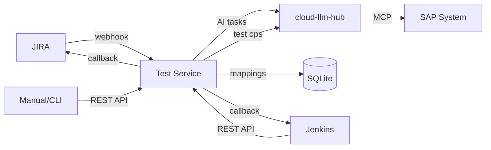
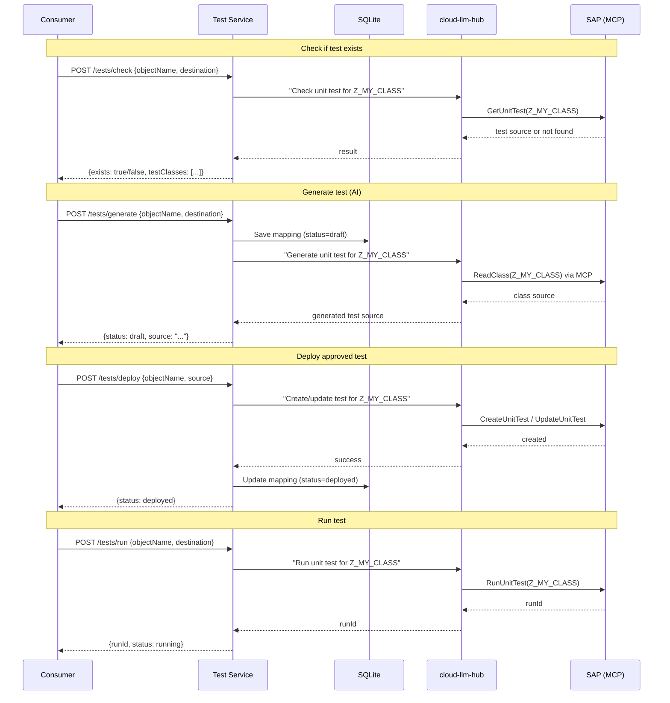

# ABAP Unit Test Service — Design Document

**Status:** Draft
**Date:** 2026-04-05

## Overview

Stateless proxy service for ABAP unit test lifecycle — check, generate (AI), deploy, run, results. Tests and run results live in the SAP system. Service stores only mappings (JIRA issue ↔ SAP test object ↔ destination) in SQLite.

## Entities

### Test (in SAP system)

ABAP unit test is a dictionary object in the SAP system. The service doesn't own it — it reads/writes via MCP tools.

- `objectName` — ABAP object under test (Z_MY_CLASS)
- `objectType` — CLAS | PROG | FUGR
- `testClassName` — local test class (LTCL_TEST_...)
- `destination` — SAP system (S4HANA_E19)
- `source` — ABAP source code

### TestRun (in SAP system)

Run results are in the SAP system. Service reads them via MCP.

- `runId` — SAP run identifier
- `status` — running | passed | failed | error
- `duration`
- `passed` / `failed` / `skipped`
- `failures` — assertion details

### TestMapping (in SQLite — service owns this)

Links external references to SAP objects:

```sql
CREATE TABLE test_mapping (
  id INTEGER PRIMARY KEY AUTOINCREMENT,
  jira_issue TEXT,
  object_name TEXT NOT NULL,
  object_type TEXT NOT NULL DEFAULT 'CLAS',
  destination TEXT NOT NULL,
  status TEXT NOT NULL DEFAULT 'unknown',
  created_at TEXT NOT NULL DEFAULT (datetime('now')),
  updated_at TEXT NOT NULL DEFAULT (datetime('now'))
);

CREATE UNIQUE INDEX idx_mapping_object ON test_mapping(object_name, destination);
CREATE INDEX idx_mapping_jira ON test_mapping(jira_issue);
```

## API

### Deterministic (direct MCP proxy)

| Method | Path | Description | MCP Tool |
|--------|------|-------------|----------|
| POST | `/tests/check` | Does test exist for object? | GetUnitTest |
| POST | `/tests/deploy` | Write approved test to SAP | CreateUnitTest / UpdateUnitTest |
| POST | `/tests/run` | Execute test | RunUnitTest |
| GET | `/tests/status` | Run status (polling) | GetUnitTestStatus |
| GET | `/tests/results` | Run results | GetUnitTestResult |

### AI-assisted (via cloud-llm-hub)

| Method | Path | Description |
|--------|------|-------------|
| POST | `/tests/generate` | AI generates test draft (not deployed) |
| POST | `/tests/analyze` | AI analyzes test failure |

### Orchestration

| Method | Path | Description |
|--------|------|-------------|
| POST | `/webhook/jira` | JIRA webhook receiver |
| GET | `/mappings` | List all test mappings |
| GET | `/health` | Health check |

## Request/Response Examples

### POST /tests/check

```json
// Request
{ "objectName": "Z_MY_CLASS", "destination": "S4HANA_E19" }

// Response — test exists
{
  "exists": true,
  "objectName": "Z_MY_CLASS",
  "objectType": "CLAS",
  "testClasses": ["LTCL_MY_CLASS_TEST"],
  "destination": "S4HANA_E19"
}

// Response — no test
{ "exists": false, "objectName": "Z_MY_CLASS", "destination": "S4HANA_E19" }
```

### POST /tests/generate

```json
// Request
{
  "objectName": "Z_MY_CLASS",
  "destination": "S4HANA_E19",
  "requirements": "Test all public methods, cover edge cases",
  "jiraIssue": "PROJ-123"
}

// Response — draft (NOT deployed to SAP)
{
  "status": "draft",
  "objectName": "Z_MY_CLASS",
  "testClassName": "LTCL_MY_CLASS_TEST",
  "source": "CLASS ltcl_my_class_test DEFINITION FOR TESTING...",
  "mappingId": 42
}
```

### POST /tests/deploy

```json
// Request
{ "objectName": "Z_MY_CLASS", "destination": "S4HANA_E19", "source": "CLASS ltcl_..." }

// Response
{ "status": "deployed", "objectName": "Z_MY_CLASS", "testClassName": "LTCL_MY_CLASS_TEST" }
```

### POST /tests/run

```json
// Request
{ "objectName": "Z_MY_CLASS", "destination": "S4HANA_E19" }

// Response
{ "runId": "abc-123", "status": "running" }
```

### GET /tests/results?objectName=Z_MY_CLASS&destination=S4HANA_E19

```json
{
  "objectName": "Z_MY_CLASS",
  "runId": "abc-123",
  "status": "failed",
  "duration": 1200,
  "passed": 4,
  "failed": 1,
  "skipped": 0,
  "failures": [
    {
      "testClass": "LTCL_MY_CLASS_TEST",
      "method": "test_empty_input",
      "message": "Expected CX_INVALID_INPUT but no exception raised",
      "line": 42
    }
  ]
}
```

### POST /webhook/jira

JIRA sends task status changes. Service reacts:

| JIRA Event | Service Action |
|------------|----------------|
| Task created (label=unit-test) | Store mapping, optionally generate |
| Subtask status → Approved | Mark mapping as approved |
| Subtask status → Rejected | Mark mapping, notify |

## Architecture



## Data Flow



## Technology

- **Runtime**: Node.js, Express (standalone, no CAP — lightweight)
- **Storage**: SQLite via `better-sqlite3`
- **AI/MCP**: cloud-llm-hub `/v1/chat/completions`
- **Auth**: Basic→Bearer middleware (same as calm-dump-analyzer)
- **Deployment**: BTP CF via MTA

## File Structure

```
test-management/
├── server.js              — Express app, routes, middleware
├── lib/
│   ├── db.js              — SQLite schema, queries
│   ├── sap-client.js      — cloud-llm-hub API calls
│   └── jira-webhook.js    — JIRA webhook handler
├── package.json
├── mta.yaml
├── xs-security.json
├── .mtaext.example
└── README.md
```

## Phase 1 Scope

- `/tests/check` — deterministic
- `/tests/generate` — AI via cloud-llm-hub
- `/tests/deploy` — deterministic
- `/tests/run` — deterministic
- `/tests/status` — deterministic
- `/tests/results` — deterministic
- `/health`
- SQLite mappings
- Basic→Bearer auth

Phase 2: JIRA webhook, callbacks, `/tests/analyze`
Phase 3: Jenkins integration, pipeline builder
